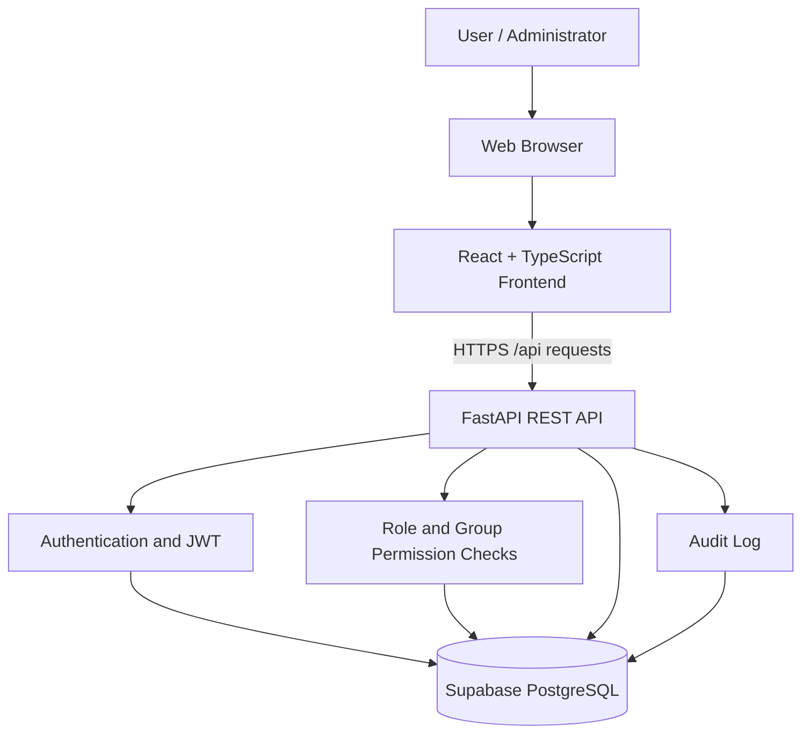
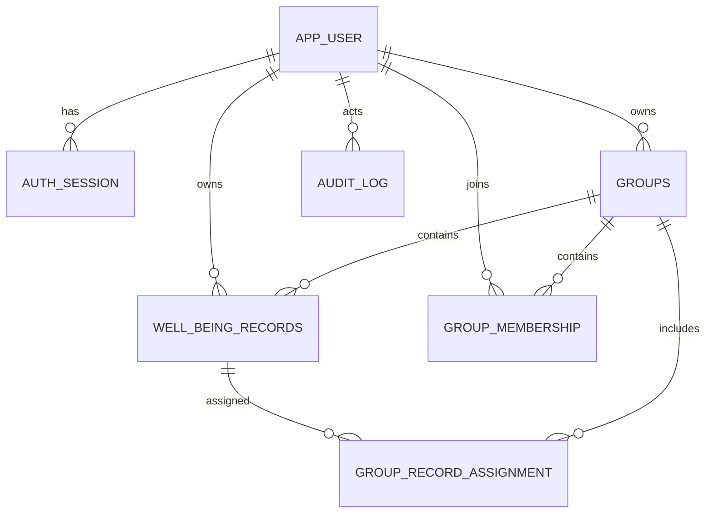

# Mental Health Analysis System
## Final Project Report

**Course:** CSE309 – Web Application & Internet  
**Department:** Computer Science & Engineering  
**Institution:** Independent University, Bangladesh  
**Semester:** Autumn 2026  
**Submitted by:** Faiza Umaima

**ID:** 2311094

**Section:** 06

**Submitted to:**  Sayef Reyadh

**Submission date:** 28/11/2026


---

# Table of Contents

- Executive Summary
- Part A – Product Requirements Document (PRD)
  - A1. Problem Statement
  - A2. Target Users and Roles
  - A3. Product Goals and Success Measures
  - A4. Scope, Non-Goals, and Assumptions
  - A5. User Stories
- Part B – Software Requirements Specification (SRS)
  - B1. Introduction, Definitions, and References
  - B2. Functional Requirements
  - B3. Non-Functional Requirements
  - B4. API and Permission Matrix
  - B5. Use Cases
  - B6. Acceptance Criteria
  - B7. Requirements Traceability Matrix
- Part C – Technical Design Document (TDD)
  - C1. Technology Stack and Versions
  - C2. System Architecture
  - C3. Project Structure
  - C4. Database Design
  - C5. API Endpoint Reference
  - C6. JWT Authentication Design
  - C7. RBAC and Group Permission Design
  - C8. Admin Dashboard Design
  - C9. Security Considerations and Threats
  - C10. Vercel Deployment and Environment Variables
  - C11. Testing
- Part D – Screenshots and Evidence
- Part E – Project Management and Reflection
  - E1. How to Run and Test the Project
  - E2. Issues, Branches, and Pull Requests
  - E3. Known Limitations
  - E4. Future Work
  - E5. Sources, Libraries, and Tools
- Appendix

---
## List of Figures


- Figure S1 – Login validation
- Figure S2 – Personal records
- Figure S3 – Profile and password validation
- Figure S4 – Session management
- Figure S5 – Group members and permissions
- Figure S6 – Group permission denial
- Figure S7 – Access-token request and expiry behavior
- Figure S8 – Refresh-token cookie requirement (not implemented in current version)
- Figure S9 – Banned-user access rejection
- Figure S10 – Admin dashboard
- Figure S11 – Admin user management
- Figure S12 – Ban user
- Figure S13 – Unban user
- Figure S14 – Change user role
- Figure S15 – CSV export
- Figure S16 – Admin record management
- Figure S17 – Admin group and audit-log management
- Figure S18 – Vercel project
- Figure S19 – Deployment environment variable names
- Figure S20 – API documentation
- Figure S21 – Automated tests (not available in inspected repository)

---
# Executive Summary

The **Mental Health Analysis System** is a web application that allows registered users to record and review basic well-being information, including mood, stress level, sleep duration, date, and optional notes. The system provides personal record management, group collaboration with permission controls, user profile and session management, and an administrator dashboard.

The application uses a React and TypeScript frontend, a Python FastAPI backend, SQLModel for database models and queries, and a PostgreSQL database hosted by Supabase. The application is deployed on Vercel.

The implemented application includes:

- User registration and login.
- JWT access and refresh token authentication.
- Personal well-being record creation, listing, editing, and deletion.
- Profile name update and password change.
- Viewing and revoking the current user's own sessions.
- Group creation and membership management.
- Group-level Create, Edit, and Assign permissions.
- Admin user management, role changes, ban/unban, record and group oversight, CSV export, statistics, and audit logs.
- Backend-enforced authentication, authorization, record ownership, and group permissions.

Since the mid-project assessment, the application was extended with authentication and session handling, profile management, group collaboration and permissions, administrative functions, improved frontend route handling, and updated project documentation. PR #20 addressed frontend SPA routing on Vercel, and PR #21 updated the README.

**Project links**

- Live application: https://2311094-s6-mental-health-analysis.vercel.app
- GitHub repository: https://github.com/faizaumaima/2311094-S6-Mental-health-Analysis
- API documentation: https://2311094-s6-mental-health-analysis.vercel.app/api/docs
- OpenAPI schema: https://2311094-s6-mental-health-analysis.vercel.app/api/openapi.json

---

# Part A – Product Requirements Document (PRD)

## A1. Problem Statement

People may want to keep a simple personal record of their mood, stress level, and sleep duration over time. Without a central place to record this information, reviewing previous entries and identifying personal patterns can be inconvenient.

The Mental Health Analysis System provides a simple web-based record-keeping application. Users can enter daily well-being information, review their own records, and manage them. Group features allow selected users to collaborate with specific permissions. Administrators can oversee users and application data.

The application is intended for personal tracking and record management. It is not a medical service and does not diagnose, treat, or predict mental health conditions.

## A2. Target Users and Roles

### 1. Registered User

A registered user can:

- Register and log in.
- View and manage their own well-being records.
- Update their profile name and change their password.
- View and revoke their own active sessions.
- Create groups and access groups in which they are members.
- Use group functions according to the permissions granted to them.

### 2. Group Owner

A group owner is the user who created a group. In addition to normal user functions, the owner can:

- Rename or delete the group.
- Add members by email.
- Remove group members.
- Configure each member's Create, Edit, and Assign permissions.

The group owner has group-level authority. Group ownership is separate from the global administrator role.

### 3. Group Member

A group member can access a group and its records. The member's ability to create, edit, or assign group records depends on the permissions granted by the group owner.

### 4. Administrator

An administrator can:

- View and search users.
- Filter users by role and account status.
- Change eligible users' roles.
- Ban or unban users.
- View and export user data as CSV.
- View and delete records and groups.
- View dashboard statistics.
- Review audit logs.

Administrative API endpoints require the administrator role on the backend.

## A3. Product Goals and Success Measures

| Goal | Success measure |
|---|---|
| Provide personal well-being record management | An authenticated user can create, list, update, and delete their own records |
| Protect personal records | A user cannot retrieve another user's private record through the API |
| Provide secure authentication | Protected API requests require a valid access token |
| Support group collaboration | A group owner can add members and configure group permissions |
| Enforce group permissions | Members without the required permission cannot perform the restricted group action |
| Provide administrative oversight | An administrator can access user, record, group, statistics, export, and audit-log functions |
| Deploy the application | The frontend and backend are accessible through the production Vercel domain |

## A4. Scope, Non-Goals, and Assumptions

### In scope

- Account registration and login.
- JWT-based authentication and refresh.
- Personal well-being record CRUD.
- Profile name and password updates.
- Current-user session listing and revocation.
- Groups, memberships, and group permissions.
- Administrator dashboard and audit logging.
- PostgreSQL persistence.
- API documentation.
- Vercel deployment.

### Out of scope / non-goals

- Artificial intelligence or machine learning.
- Large language models, RAG, or chatbot functionality.
- Medical diagnosis or treatment recommendations.
- Crisis detection or emergency response.
- Clinical assessment or professional medical advice.
- Automated interpretation of a user's mental health condition.

### Assumptions

- Users have access to a modern web browser and an internet connection.
- Users provide a valid email address during registration.
- The backend environment is configured with the required database connection and authentication secrets.
- The deployed frontend and backend are served under the configured Vercel domain.
- Administrators are trusted to use administrative capabilities responsibly.

## A5. User Stories

| ID | User story | Priority |
|---|---|---|
| US-01 | As a visitor, I want to register an account so that I can use the application | High |
| US-02 | As a registered user, I want to log in so that I can access my account | High |
| US-03 | As a user, I want to record my mood so that I can keep a personal history | High |
| US-04 | As a user, I want to record my stress level so that I can review it later | High |
| US-05 | As a user, I want to record my sleep duration so that I can maintain a history of my sleep | High |
| US-06 | As a user, I want to add an optional note to a record so that I can store context | Medium |
| US-07 | As a user, I want to view my records so that I can review previous entries | High |
| US-08 | As a user, I want to edit my own record so that I can correct information | High |
| US-09 | As a user, I want to delete my own record so that I can remove an unwanted entry | High |
| US-10 | As a user, I want to update my profile name so that my profile information stays current | Medium |
| US-11 | As a user, I want to change my password so that I can maintain account security | High |
| US-12 | As a user, I want to view my active sessions so that I can review account access | Medium |
| US-13 | As a user, I want to revoke one of my sessions so that I can end that session | Medium |
| US-14 | As a user, I want to create a group so that I can collaborate with other users | Medium |
| US-15 | As a group owner, I want to add members by email so that selected users can join my group | Medium |
| US-16 | As a group owner, I want to grant Create, Edit, and Assign permissions separately | High |
| US-17 | As a group owner, I want to rename or delete my group so that I can manage it | Medium |
| US-18 | As a group member, I want to work with group records according to my permissions | High |
| US-19 | As an administrator, I want to search and filter users so that I can manage accounts | High |
| US-20 | As an administrator, I want to ban or unban eligible users so that I can manage account access | High |
| US-21 | As an administrator, I want to change user roles so that I can manage application access | High |
| US-22 | As an administrator, I want to view and export user information so that I can review account data | Medium |
| US-23 | As an administrator, I want to view and manage records and groups so that I can oversee the application | Medium |
| US-24 | As an administrator, I want to review audit logs so that I can inspect administrative actions | Medium |

---

# Part B – Software Requirements Specification (SRS)

## B1. Introduction, Definitions, and References

### Purpose

This SRS describes the functional and non-functional requirements of the Mental Health Analysis System. It defines the expected behavior of users, group owners, group members, administrators, and the application's REST API.

### Definitions

| Term | Meaning |
|---|---|
| API | Application Programming Interface |
| CRUD | Create, Read, Update, Delete |
| JWT | JSON Web Token |
| RBAC | Role-Based Access Control |
| Access token | Short-lived token used to access protected API endpoints |
| Refresh token | Token used to obtain a new access token |
| Group owner | User who created and controls a group |
| Group permission | A Create, Edit, or Assign permission for a group member |
| Audit log | A stored record of an administrative or security-related action |
| SPA | Single Page Application |

### References

- Project repository: https://github.com/faizaumaima/2311094-S6-Mental-health-Analysis
- Deployed application: https://2311094-s6-mental-health-analysis.vercel.app
- FastAPI documentation: https://fastapi.tiangolo.com/
- React documentation: https://react.dev/
- SQLModel documentation: https://sqlmodel.tiangolo.com/
- Vercel documentation: https://vercel.com/docs
- Supabase documentation: https://supabase.com/docs

## B2. Functional Requirements

### Authentication requirements (FR-AUTH)

| ID | Requirement |
|---|---|
| FR-AUTH-01 | The system shall allow a visitor to register using a name, email, and password |
| FR-AUTH-02 | The system shall validate the registration name length and email format |
| FR-AUTH-03 | The system shall require a password of at least 8 characters and at most 128 characters during registration |
| FR-AUTH-04 | The system shall reject duplicate email addresses |
| FR-AUTH-05 | The system shall allow a registered user to log in using email and password |
| FR-AUTH-06 | The system shall issue access and refresh tokens after successful login |
| FR-AUTH-07 | The system shall require a valid access token for protected user endpoints |
| FR-AUTH-08 | The system shall allow a user to refresh an access token using a valid refresh token |
| FR-AUTH-09 | The system shall allow a user to log out and revoke the associated refresh-token session |
| FR-AUTH-10 | The system shall allow a user to update their profile name |
| FR-AUTH-11 | The system shall allow a user to change their password after providing the current password |
| FR-AUTH-12 | The system shall allow a user to list and revoke their own sessions |

### Role and permission requirements (FR-RBAC)

| ID | Requirement |
|---|---|
| FR-RBAC-01 | The system shall support global `user` and `admin` roles |
| FR-RBAC-02 | The backend shall enforce administrator-only endpoints |
| FR-RBAC-03 | The backend shall restrict personal record access to the record owner |
| FR-RBAC-04 | The backend shall restrict group access to the group owner or a group member |
| FR-RBAC-05 | The backend shall enforce group Create, Edit, and Assign permissions |
| FR-RBAC-06 | The group owner shall be allowed to manage group membership and permissions |
| FR-RBAC-07 | The system shall reject unauthorized actions with an appropriate HTTP error response |

### Administrator requirements (FR-ADM)

| ID | Requirement |
|---|---|
| FR-ADM-01 | The administrator shall be able to list users |
| FR-ADM-02 | The administrator shall be able to search users by email |
| FR-ADM-03 | The administrator shall be able to filter users by role and active status |
| FR-ADM-04 | The administrator shall be able to view paginated user results |
| FR-ADM-05 | The administrator shall be able to export users as a CSV file |
| FR-ADM-06 | The administrator shall be able to ban an eligible user with a reason |
| FR-ADM-07 | The administrator shall be able to unban a user |
| FR-ADM-08 | The administrator shall be able to change an eligible user's role to `user` or `admin` |
| FR-ADM-09 | The administrator shall be able to view dashboard statistics |
| FR-ADM-10 | The administrator shall be able to list and delete records |
| FR-ADM-11 | The administrator shall be able to list and delete groups |
| FR-ADM-12 | The administrator shall be able to view and filter audit logs |
| FR-ADM-13 | The system shall prevent an administrator from banning themselves |
| FR-ADM-14 | The system shall prevent an administrator from changing their own role |
| FR-ADM-15 | The system shall prevent an administrator from banning another administrator |

### Domain requirements (FR-DOMAIN)

| ID | Requirement |
|---|---|
| FR-DOM-01 | The system shall support the moods happy, calm, neutral, anxious, sad, and angry |
| FR-DOM-02 | The system shall require a stress level from 1 through 10 |
| FR-DOM-03 | The system shall require sleep hours from 0 through 24 |
| FR-DOM-04 | The system shall accept a valid record date |
| FR-DOM-05 | The system shall allow optional notes up to 1000 characters |
| FR-DOM-06 | The system shall allow a user to create a well-being record |
| FR-DOM-07 | The system shall allow a user to list their own records |
| FR-DOM-08 | The system shall allow a user to retrieve, update, and delete their own record |
| FR-DOM-09 | The system shall allow a user to create and list accessible groups |
| FR-DOM-10 | The group owner shall be able to add and remove members |
| FR-DOM-11 | The group owner shall be able to rename and delete the group |
| FR-DOM-12 | The group owner shall be able to configure member permissions |
| FR-DOM-13 | An authorized group member shall be able to create, view, edit, or assign group records according to granted permissions |

## B3. Non-Functional Requirements

| ID | Requirement | Measure / verification |
|---|---|---|
| NFR-01 | Authentication shall be required for protected operations | Unauthenticated protected API request returns 401 |
| NFR-02 | Authorization shall be enforced by the backend | Unauthorized role or permission returns 403 or an access-denied response |
| NFR-03 | Personal records shall be isolated by ownership | A different user's record is not returned to the requester |
| NFR-04 | Passwords shall not be stored as plain text | Password hashes are stored using Argon2 with an application pepper |
| NFR-05 | JWTs shall have limited lifetimes | Access token defaults to 15 minutes; refresh token defaults to 7 days |
| NFR-06 | Refresh sessions shall be revocable | Refresh-token hashes are stored with session status and expiry |
| NFR-07 | Secrets shall be supplied through environment configuration | Secret values are not committed in the example configuration |
| NFR-08 | The application shall provide API documentation | OpenAPI documentation is available at `/api/docs` |
| NFR-09 | The application shall persist application data | PostgreSQL is used through SQLModel |
| NFR-10 | The interface shall support common browser navigation | React Router routes are available in the deployed SPA |
| NFR-11 | The application shall provide useful validation feedback | Invalid input is rejected by backend schema validation |
| NFR-12 | Administrative actions shall be traceable | Relevant actions create audit-log entries |

## B4. API and Permission Matrix

### Global role matrix

| Operation | Visitor | User | Admin |
|---|---:|---:|---:|
| Register | Yes | Yes | Yes |
| Login | Yes | Yes | Yes |
| Access own records | No | Yes | Yes, through admin oversight endpoints |
| Access profile and own sessions | No | Yes | Yes |
| Access groups as owner/member | No | Yes | Yes, if group owner/member |
| Access `/api/admin/*` endpoints | No | No | Yes |

The administrator role does not automatically grant group-owner privileges or the group's Create/Edit/Assign permissions. Group ownership and membership permissions are checked separately.

### Group permission matrix

| Group action | Owner | Member with permission | Member without permission | Non-member |
|---|---:|---:|---:|---:|
| View group/member information | Yes | Yes | Yes | No |
| Rename group | Yes | No | No | No |
| Delete group | Yes | No | No | No |
| Add/remove members | Yes | No | No | No |
| Change member permissions | Yes | No | No | No |
| Create group record | Yes | `can_create` | No | No |
| View group records | Yes | Yes | Yes | No |
| Edit group record | Yes | `can_edit` | No | No |
| Assign group record | Yes | `can_assign` | No | No |

### Important HTTP responses

| Status | Meaning in this application |
|---|---|
| 200 | Successful read or update |
| 201 | Resource created |
| 204 | Successful operation with no response body, such as deletion or logout |
| 400 | Invalid operation, such as incorrect current password or prohibited owner action |
| 401 | Missing, invalid, expired, or unsuitable access token |
| 403 | Authenticated user is not permitted to perform the action |
| 404 | Resource does not exist or is not accessible under the relevant ownership rule |
| 409 | Duplicate registration email |
| 422 | Request validation failure |

## B5. Use Cases

### UC-01: Register an account

- **Actor:** Visitor
- **Precondition:** The visitor is not already registered with the email address.
- **Main flow:**
  1. Visitor opens the registration page.
  2. Visitor enters name, email, and password.
  3. Frontend submits the registration request.
  4. Backend validates the data.
  5. Backend creates the user with the default `user` role.
  6. The API returns the created user response.
- **Alternative flow:** Invalid data is rejected; an already-used email returns a conflict response.
- **Postcondition:** A user account is created.

### UC-02: Log in

- **Actor:** Registered user or administrator
- **Precondition:** Account exists and is active.
- **Main flow:**
  1. Actor enters email and password.
  2. Frontend sends login request.
  3. Backend verifies the password hash.
  4. Backend issues access and refresh tokens.
  5. Frontend stores the tokens according to its token-handling implementation.
  6. The user is taken to the authenticated application.
- **Alternative flow:** Invalid credentials are rejected. An inactive account cannot log in.
- **Postcondition:** A valid authentication session is created.

### UC-03: Create a personal record

- **Actor:** Authenticated user
- **Precondition:** User has a valid access token.
- **Main flow:**
  1. User opens the Records page.
  2. User enters mood, stress level, sleep hours, date, and optional notes.
  3. Frontend sends a create request.
  4. Backend validates the data and associates the record with the current user.
  5. Backend stores the record and returns the created resource.
- **Alternative flow:** Invalid values are rejected by schema validation.
- **Postcondition:** The record is stored under the user's ownership.

### UC-04: Update or delete a personal record

- **Actor:** Authenticated user
- **Precondition:** The target record belongs to the user.
- **Main flow:** User selects a record, edits and saves it, or confirms deletion. Backend checks ownership before applying the operation.
- **Alternative flow:** A record belonging to another user is not returned as an accessible record.
- **Postcondition:** The record is updated or deleted.

### UC-05: Create and manage a group

- **Actor:** Authenticated user / group owner
- **Precondition:** User is logged in.
- **Main flow:**
  1. User creates a group with a name.
  2. Backend stores the group with the creator as owner.
  3. Owner adds members using their email addresses.
  4. Owner sets member permissions.
  5. Owner may rename or delete the group.
- **Alternative flow:** A non-owner attempting owner-only actions is rejected.
- **Postcondition:** Group and membership data reflect the owner's actions.

### UC-06: Use a group record permission

- **Actor:** Group owner or member
- **Precondition:** Actor has access to the group.
- **Main flow:** Actor requests a group-record operation. Backend checks group membership and the relevant permission before executing it.
- **Alternative flow:** Missing Create, Edit, or Assign permission results in access denial.
- **Postcondition:** Only an authorized operation is completed.

### UC-07: Administrator manages a user

- **Actor:** Administrator
- **Precondition:** Administrator is authenticated.
- **Main flow:** Administrator searches for a user, reviews the account, and performs an eligible role change, ban, or unban action.
- **Alternative flow:** Self-ban, self-role-change, and banning another administrator are rejected.
- **Postcondition:** Account state or role is updated and an audit entry is created.

### UC-08: Administrator reviews application data

- **Actor:** Administrator
- **Precondition:** Administrator is authenticated.
- **Main flow:** Administrator views statistics, users, records, groups, and audit logs, and may export the user list or delete selected records/groups.
- **Alternative flow:** Missing resources return a not-found response.
- **Postcondition:** Data is reviewed; destructive actions are recorded in the audit log where implemented.

## B6. Acceptance Criteria

| ID | Acceptance criterion | Verification |
|---|---|---|
| AC-01 | A valid registration creates a user | Register through the UI or API and verify successful response |
| AC-02 | Duplicate email registration is rejected | Submit the same email again and verify conflict response |
| AC-03 | Incorrect login credentials are rejected | Submit an incorrect password and verify authentication failure |
| AC-04 | A protected endpoint rejects a missing or invalid access token | Call a protected endpoint without a valid bearer token; expect 401 |
| AC-05 | An expired access token is rejected | Call a protected endpoint with an expired token; expect 401 |
| AC-06 | A token with an invalid signature or unsuitable token type is rejected | Submit a tampered token or refresh token as an access token; expect 401 |
| AC-07 | A user can access their own record | Retrieve a record owned by the authenticated user |
| AC-08 | A user cannot access another user's private record | Attempt to retrieve another user's record; the tested cross-owner request returned 404 |
| AC-09 | A member without a required group permission cannot perform that action | Attempt a group create/edit/assign action without the relevant permission; expect access denial |
| AC-10 | A non-admin cannot access the admin API | Call an admin endpoint as a normal user; expect 403 |
| AC-11 | An administrator cannot ban themselves | Attempt self-ban; expect 403 |
| AC-12 | An administrator cannot change their own role | Attempt self-role-change; expect 403 |
| AC-13 | An administrator cannot ban another administrator | Attempt to ban an admin account; expect 403 |
| AC-14 | A banned user cannot continue accessing protected resources | Ban an account and make a subsequent protected request; inactive account is rejected |
| AC-15 | A user can revoke their own session | Revoke a session through the session endpoint and verify the session is marked revoked |
| AC-16 | A successful delete returns no content | Verify delete endpoint returns 204 |

**Refresh-token storage qualification:** The backend rotates refresh tokens and stores only a SHA-256 hash of each refresh token in the database. The current frontend stores the refresh token in browser `localStorage` and sends it in the JSON request body. It does **not** use an `httpOnly` cookie. Therefore, an `httpOnly` cookie acceptance criterion is not met by the current implementation.

## B7. Requirements Traceability Matrix

| Requirement group | Main implementation | Evidence / verification |
|---|---|---|
| FR-AUTH-01 to FR-AUTH-09 | `backend/app/auth/router.py`, `service.py`, `core/tokens.py` | Registration, login, refresh, logout and protected API checks |
| FR-AUTH-10 to FR-AUTH-12 | Auth router and `frontend/src/pages/Profile.tsx` | Profile, password and own-session operations |
| FR-RBAC-01 to FR-RBAC-07 | `backend/app/auth/dependencies.py`, `rbac.py`, group router | Admin and group authorization checks |
| FR-ADM-01 to FR-ADM-15 | `backend/app/admin/router.py`, `service.py`, `frontend/src/pages/Admin.tsx` | Admin UI/API checks and audit logs |
| FR-DOM-01 to FR-DOM-08 | `backend/app/records/schemas.py`, `records/router.py`, Records UI | Record validation and CRUD |
| FR-DOM-09 to FR-DOM-13 | `backend/app/groups/`, `rbac.py`, Groups UI | Group membership and permission checks |
| NFR-01 to NFR-07 | Auth dependencies, security and token modules, environment configuration | Authentication, authorization and configuration inspection |
| NFR-08 | FastAPI application configuration | `/api/docs` and `/api/openapi.json` |
| NFR-09 | SQLModel and database configuration | PostgreSQL-backed application operation |
| NFR-10 to NFR-12 | React Router, schemas, audit service | Browser routes, validation and audit-log entries |

---

# Part C – Technical Design Document (TDD)

## C1. Technology Stack and Versions

### Frontend

| Technology | Version / configuration |
|---|---|
| React | 19.3.0 |
| React DOM | 19.3.0 |
| TypeScript | 7.0.2 |
| Vite | 8.3.2 |
| React Router DOM | 7.18.6 |

### Backend

| Technology | Version / configuration |
|---|---|
| Python | Project requires Python >= 3.10; development environment used Python 3.13 |
| FastAPI | 0.162.0 |
| SQLModel | 0.0.48 |
| PyJWT | 2.15.1 |
| argon2-cffi | 25.1.0 |
| psycopg2-binary | 2.9.13 |
| psycopg | 3.3.6 |

### Database and deployment

| Component | Technology |
|---|---|
| Relational database | PostgreSQL |
| Database hosting | Supabase |
| ORM / data models | SQLModel |
| Frontend and backend hosting | Vercel |
| Version control | Git and GitHub |

Versions are based on the inspected development environment and package configuration. Deployment package versions may differ if dependencies are resolved separately during deployment.

## C2. System Architecture

The system uses a client-server architecture.



### Request flow

1. The user interacts with the React frontend in a browser.
2. The frontend sends REST API requests to the `/api` path.
3. Vercel routes `/api/*` requests to the FastAPI backend.
4. FastAPI validates the request and authentication token.
5. Authorization checks verify global role, record ownership, group membership, or group permission as required.
6. SQLModel interacts with the PostgreSQL database.
7. The backend returns a JSON response or an appropriate HTTP status code.
8. The frontend updates the page based on the response.

## C3. Project Structure

The following is a simplified source tree. Generated folders such as `.venv`, `node_modules`, `dist`, and `__pycache__` are omitted.

```text
2311094-S6-Mental-health-Analysis/
├── .agents/
├── .claude/
├── backend/
│   ├── app/
│   │   ├── admin/
│   │   │   ├── models.py
│   │   │   ├── router.py
│   │   │   └── service.py
│   │   ├── auth/
│   │   │   ├── dependencies.py
│   │   │   ├── models.py
│   │   │   ├── router.py
│   │   │   ├── schemas.py
│   │   │   └── service.py
│   │   ├── core/
│   │   │   ├── security.py
│   │   │   └── tokens.py
│   │   ├── groups/
│   │   │   ├── models.py
│   │   │   ├── router.py
│   │   │   ├── schemas.py
│   │   │   └── service.py
│   │   ├── records/
│   │   │   ├── crud.py
│   │   │   ├── models.py
│   │   │   ├── router.py
│   │   │   └── schemas.py
│   │   ├── database.py
│   │   └── rbac.py
│   ├── main.py
│   ├── requirements.txt
│   └── .env.example
├── docs/
│   ├── PRD.md
│   ├── SRS.md
│   └── TDD.md
├── frontend/
│   ├── src/
│   │   ├── components/
│   │   ├── context/
│   │   ├── pages/
│   │   ├── services/
│   │   ├── types/
│   │   ├── App.tsx
│   │   ├── index.css
│   │   └── main.tsx
│   ├── package.json
│   └── ...
├── .gitignore
├── LICENSE
├── README.md
├── pyproject.toml
└── vercel.json
```

## C4. Database Design

The application uses PostgreSQL. SQLModel defines the database models.

### Main entities

| Table | Important fields | Purpose |
|---|---|---|
| `app_user` | `id`, `name`, `email`, `password_hash`, `role`, `is_active`, `ban_reason`, `failed_login_count`, `created_at` | Stores user accounts and account status |
| `auth_session` | `id`, `user_id`, `refresh_token_hash`, `expires_at`, `revoked`, `created_at` | Stores refresh-token session metadata |
| `well_being_records` | `id`, `mood`, `stress_level`, `sleep_hours`, `record_date`, `notes`, `created_at`, `owner_id`, `group_id` | Stores well-being records |
| `groups` | `id`, `name`, `owner_id`, `created_at` | Stores groups and their owners |
| `group_membership` | `id`, `group_id`, `user_id`, `can_create`, `can_edit`, `can_assign`, `created_at` | Stores group membership and permissions |
| `group_record_assignment` | `id`, `record_id`, `group_id`, `assigned_to`, `assigned_by`, `created_at` | Stores group record assignment information |
| `audit_log` | `id`, `actor_user_id`, `action`, `target_user_id`, `details`, `created_at` | Stores audit events |

### Entity relationship diagram



### Relationship notes

- A user can have multiple authentication sessions.
- A user can own multiple well-being records.
- A user can own multiple groups.
- A group can have multiple members through `group_membership`.
- The `group_membership` table has a uniqueness constraint for the combination of group and user.
- Group permissions are stored as boolean fields: `can_create`, `can_edit`, and `can_assign`.
- A well-being record can be associated with an owner and optionally a group.
- Audit entries identify the acting user and may identify a target user.

## C5. API Endpoint Reference

All API routes use the `/api` prefix. Protected endpoints require a valid access token unless stated otherwise.

### General

| Method | Endpoint | Purpose |
|---|---|---|
| GET | `/api/health` | Health check |
| GET | `/api/hello` | Simple hello response |
| GET | `/api/docs` | Interactive API documentation |
| GET | `/api/openapi.json` | OpenAPI schema |

### Authentication and user sessions

| Method | Endpoint | Purpose |
|---|---|---|
| POST | `/api/auth/register` | Register an account |
| POST | `/api/auth/login` | Authenticate and issue tokens |
| GET | `/api/auth/me` | Get current user profile |
| POST | `/api/auth/refresh` | Rotate/refresh tokens |
| POST | `/api/auth/logout` | Revoke the refresh-token session |
| POST | `/api/auth/change-password` | Change password |
| PUT | `/api/auth/me` | Update profile name |
| GET | `/api/users/me/sessions` | List current user's sessions |
| DELETE | `/api/users/me/sessions/{session_id}` | Revoke one of the current user's sessions |

### Personal records

| Method | Endpoint | Purpose |
|---|---|---|
| POST | `/api/records/` | Create a personal record; returns 201 |
| GET | `/api/records/` | List current user's records |
| GET | `/api/records/{record_id}` | Retrieve an owned record |
| PUT | `/api/records/{record_id}` | Update an owned record |
| DELETE | `/api/records/{record_id}` | Delete an owned record; returns 204 |

### Groups

| Method | Endpoint | Purpose |
|---|---|---|
| POST | `/api/groups/` | Create a group; returns 201 |
| GET | `/api/groups/` | List accessible groups |
| GET | `/api/groups/{group_id}/members` | List group members |
| PUT | `/api/groups/{group_id}` | Rename a group (owner only) |
| POST | `/api/groups/{group_id}/members` | Add a member (owner only); returns 201 |
| PUT | `/api/groups/{group_id}/members/{user_id}/permissions` | Update member permissions (owner only) |
| DELETE | `/api/groups/{group_id}/members/{user_id}` | Remove a member (owner only) |
| POST | `/api/groups/{group_id}/records` | Create group record; requires Create permission |
| GET | `/api/groups/{group_id}/records` | List group records |
| PUT | `/api/groups/{group_id}/records/{record_id}` | Update group record; requires Edit permission |
| POST | `/api/groups/{group_id}/records/{record_id}/assign` | Assign group record; requires Assign permission |
| DELETE | `/api/groups/{group_id}` | Delete group (owner only); returns 204 |

### Administration

All `/api/admin/*` endpoints require the administrator role.

| Method | Endpoint | Purpose |
|---|---|---|
| GET | `/api/admin/users` | List/search/filter/paginate users |
| GET | `/api/admin/users/export` | Export users as CSV |
| PATCH | `/api/admin/users/{user_id}/ban` | Ban an eligible user |
| PATCH | `/api/admin/users/{user_id}/unban` | Unban a user |
| PUT | `/api/admin/users/{user_id}/role` | Change user role |
| GET | `/api/admin/stats` | Get dashboard statistics |
| GET | `/api/admin/records` | List records, optionally filtered by group or owner |
| DELETE | `/api/admin/records/{record_id}` | Delete a record |
| GET | `/api/admin/groups` | List groups |
| DELETE | `/api/admin/groups/{group_id}` | Delete a group |
| GET | `/api/admin/audit-log` | List/filter audit logs |

## C6. JWT Authentication Design

The backend uses JSON Web Tokens signed with the HS256 algorithm.

### Token configuration

| Setting | Default |
|---|---|
| Algorithm | HS256 |
| Access token lifetime | 15 minutes |
| Refresh token lifetime | 7 days |
| Signing secret | `JWT_SECRET` environment variable |

### Access token claims

- `sub`: user ID
- `role`: global role
- `type`: `access`
- `exp`: expiration time

### Refresh token claims

- `sub`: user ID
- `type`: `refresh`
- `exp`: expiration time

### Token lifecycle

1. The user submits valid login credentials.
2. Backend verifies the stored Argon2 password hash with the configured pepper.
3. Backend issues an access token and refresh token.
4. The refresh token is hashed with SHA-256 and the hash is stored in `auth_session`.
5. The frontend keeps the access token in module memory and the refresh token in browser `localStorage`.
6. When a protected API request receives an authentication failure, the frontend attempts a refresh request.
7. Backend validates the refresh token and its session, revokes the old session, and issues a new token pair.
8. Logout revokes the matching refresh-token session.

### Password protection

Passwords are hashed using `argon2-cffi`. The application appends the configured `PEPPER` value before hashing and verification. Plain-text passwords are not stored in the database.

### Important implementation detail

The current frontend sends the refresh token in the JSON body of `/api/auth/refresh` and stores it in `localStorage`. It does not currently use an `httpOnly` cookie. This is a known security improvement opportunity.

## C7. RBAC and Group Permission Design

### Global role checks

- Normal user endpoints require a valid authenticated user.
- Administrator endpoints use `require_admin`.
- The admin router applies the administrator dependency to all routes under `/api/admin`.

### Record ownership

Personal record endpoints use the authenticated user's ID as the owner. A request for a record that is not owned by the current user is not returned as an accessible record.

### Group authorization

The backend includes reusable checks:

- `get_group_or_404`: finds a group or returns not found.
- `require_group_owner`: checks that the current user owns the group.
- `require_group_access`: checks that the user is the owner or a member.
- `require_group_permission`: checks the relevant group permission.

A group owner is allowed to perform owner-level group operations. Members must have the specific permission needed for Create, Edit, or Assign operations.

### Permission fields

| Field | Capability |
|---|---|
| `can_create` | Create group records |
| `can_edit` | Edit group records |
| `can_assign` | Assign group records |

The backend is the final authority for these checks. Hiding a button in the frontend is not treated as sufficient security.

## C8. Admin Dashboard Design

The administrator dashboard provides:

1. **Statistics:** total users, banned users, total records, total groups, new users in the last seven days, and new records in the last seven days.
2. **User management:** email search, role filter, active-status filter, pagination, and CSV export.
3. **Account actions:** ban, unban, and role change.
4. **Record oversight:** list all records and delete a record.
5. **Group oversight:** list all groups and delete a group.
6. **Audit logs:** review action history with action and user filters.

### Administrative safeguards

- An administrator cannot ban themselves.
- An administrator cannot change their own role.
- An administrator cannot ban another administrator.
- Ban operations require a reason.
- Relevant actions create audit-log entries.

The current implementation provides users with the ability to list and revoke **their own** sessions. An administrator-side endpoint to revoke another user's sessions was not found in the inspected admin router and is not claimed as an implemented feature.

## C9. Security Considerations and Threats

| Threat | Current mitigation / behavior | Remaining consideration |
|---|---|---|
| Unauthorized API access | Protected endpoints require bearer authentication | Continue testing all protected routes |
| Invalid or expired access token | JWT verification and expiration validation; 401 response | Automated security tests would improve regression coverage |
| Token type confusion | Access-token dependency requires `type=access` | Continue testing token misuse |
| Password disclosure from database | Argon2 password hashing and pepper | Protect environment secrets and database access |
| Refresh-token replay | Refresh-token hash stored; refresh rotation revokes the old session | Frontend storage in localStorage remains a risk |
| Cross-user record access | Backend ownership checks | Continue testing all record operations |
| Unauthorized group actions | Backend group owner, membership, and permission checks | Test each permission combination |
| Unauthorized admin access | Global `require_admin` dependency on admin router | Keep admin role assignment restricted |
| Administrator misuse | Self-ban, self-role-change, and admin-to-admin ban restrictions; audit logs | Review audit logs regularly |
| Banned account access | Inactive users are rejected by authentication checks | Verify all relevant endpoints after ban |
| Secret leakage | `.env.example` contains variable names but no values | Never commit real `.env` files or credentials |
| Invalid input | Pydantic/SQLModel schema validation | Frontend form validation can be improved consistently |

### Security limitations

- The frontend currently stores the refresh token in `localStorage`, not an `httpOnly` cookie.
- The authentication service increments `failed_login_count` for failed attempts where the user exists, but an enforced account lockout policy was not identified in the inspected implementation.
- Automated test files were not found in the repository during the project inspection.
- Email verification, password-reset workflow, and two-factor authentication are not claimed as implemented.

## C10. Vercel Deployment and Environment Variables

### Deployment configuration

The root `vercel.json` defines two services:

- Backend service: root directory `backend`, framework `fastapi`, entrypoint `main:app`.
- Frontend service: root directory `frontend`, framework `vite`.

Routing rules:

- `/api/(.*)` is routed to the backend service.
- Other paths are routed to the frontend service.
- Frontend rewrite sends SPA routes to `/index.html`.

This allows the frontend and backend to operate under the same deployed domain.

### Environment variables

The backend `.env.example` identifies the following variables:

| Variable | Purpose |
|---|---|
| `JWT_SECRET` | Secret used to sign and verify JWTs |
| `PEPPER` | Additional secret used in password hashing |
| `ACCESS_TOKEN_MINUTES` | Access token lifetime; example default is 15 |
| `REFRESH_TOKEN_DAYS` | Refresh token lifetime; example default is 7 |
| `FRONTEND_ORIGIN` | Frontend origin configuration |
| `DATABASE_URL` | PostgreSQL database connection used by the database configuration |

**Security note:** Actual secret values must be configured privately in the deployment environment. They must not be included in this report, source control, screenshots, or public documentation.

## C11. Testing

### Manual production verification

The deployed application was manually checked using a browser and API requests.

| Test area | Observed result |
|---|---|
| Frontend direct routes | `/login`, `/groups`, and `/admin` loaded through direct navigation and hard refresh |
| Unauthenticated route protection | Logged-out access to `/groups` and `/admin` redirected to login |
| Admin authentication | Admin login and `/api/auth/me` succeeded |
| Admin dashboard APIs | Statistics, user list, audit log, and records endpoints returned successful responses |
| Admin logout | After logout, direct `/admin` navigation redirected to login |
| Record ownership | A normal user could retrieve their own record |
| Cross-owner protection | The tested request for another user's record returned 404 |
| Normal user admin restriction | A normal user was redirected away from the admin page; backend admin access is separately protected |
| Group interface | Group members and Create/Edit/Assign permission controls were displayed |
| Admin data views | Admin records, groups, and audit log views loaded |

### Example API observations

- `GET /api/auth/me` – 200 in the tested authenticated session.
- `GET /api/admin/stats` – 200 in the tested administrator session.
- `GET /api/admin/users?page=1&page_size=10` – 200 in the tested administrator session.
- `GET /api/admin/audit-log?page=1` – 200 in the tested administrator session.
- `GET /api/admin/records` – 200 in the tested administrator session.
- `GET /api/records/{own_record_id}` – 200 for the tested owner.
- `GET /api/records/{other_user_record_id}` – 404 in the cross-owner test.
- `DELETE /api/records/{record_id}` – designed to return 204 after successful deletion.

### Automated testing status

A repository search for Python test files and TypeScript test/spec files returned no matching test files. Therefore, no automated test suite is claimed in this report. The testing evidence listed above is manual production verification.

### Screenshot evidence

Add the actual screenshots in Part D. Do not create or label a screenshot as evidence unless it has been captured from the running application or a real test session.

---

# Part D – Screenshots and Evidence

**Instructions for final submission**

- Capture screenshots from the deployed application.
- Keep the browser address bar visible where requested.
- Show the logged-in account context where appropriate, but do not expose passwords, full access tokens, refresh tokens, or secrets.
- Mask email addresses or personal information if required by the course or privacy expectations.
- Use the figure numbers below in captions and in the List of Figures.
- If a requested feature is not implemented, mark it as **Not implemented** rather than creating a misleading screenshot.

## Screenshot checklist

| Figure | Required evidence | Status / file |
|---|---|---|

| S1 | Login page showing validation behavior |  |


| S2 | Logged-in user's own records page |  |
| S3 | Profile/password page showing incorrect current-password handling |  |
| S4 | Sessions page showing active sessions and own-session revoke control |  |
| S5 | Groups page showing members and permission controls |  |
| S6 | Evidence of a denied group permission request (403 or equivalent) |  |
| S7 | Network request showing masked Authorization header and expired-token 401 behavior |  |
| S8 | Refresh request showing a new token and an `httpOnly` cookie | **Not implemented as specified:** current frontend stores refresh token in localStorage and sends it in JSON |
| S9 | Evidence that a banned user is rejected on a subsequent protected request |   |
| S10 | Admin dashboard overview/statistics |  |
| S11 | Admin user list/search/filter |  |
| S12 | Admin ban action and result |  |
| S13 | Admin unban action and result |  |
| S14 | Admin role-change action and result |  |
| S15 | Admin CSV export |  |
| S16 | Admin all-records view and delete action |  |
| S17 | Admin groups and audit-log views |   |
| S18 | Vercel project deployment overview |  |
| S19 | Vercel environment variable names only, with values hidden |  |
| S20 | Deployed API documentation at `/api/docs` |  |
| S21 | Automated test run | **No automated test files were found in the inspected repository.** Do not fabricate this screenshot. If the faculty requires S21, ask whether a documented manual test run is acceptable or add genuine automated tests first. |


---

# Part E – Project Management and Reflection

## E1. How to Run and Test the Project

### Prerequisites

- Python 3.10 or newer.
- Node.js and npm.
- PostgreSQL database or configured Supabase project.
- Git.
- Required backend environment variables.

### Backend setup (Windows PowerShell)

From the repository root:

```powershell
cd backend
python -m venv .venv
.\.venv\Scripts\Activate.ps1
pip install -r requirements.txt
```

Create a private `.env` file in the backend directory using `.env.example` as a reference. Set the database URL and required authentication configuration privately. Do not commit `.env`.

Start the backend development server:

```powershell
fastapi dev main.py
```

The local API documentation is available at:

```text
http://127.0.0.1:8000/api/docs
```

### Frontend setup

Open another PowerShell terminal from the repository root:

```powershell
cd frontend
npm install
npm run dev
```

Vite displays the local frontend URL in the terminal, commonly:

```text
http://localhost:5173
```

### Production URLs

- Application: https://2311094-s6-mental-health-analysis.vercel.app
- API docs: https://2311094-s6-mental-health-analysis.vercel.app/api/docs

### Testing

Use the API documentation or browser developer tools to verify registration, login, record CRUD, ownership restrictions, group permissions, admin restrictions, and session behavior. Never share real passwords, token values, or environment secrets in screenshots or reports.

## E2. Issues, Branches, and Pull Requests

The project uses Git and GitHub for version control. Work is organized through feature or bug-fix branches and pull requests rather than committing all changes directly to the main branch.

### Verified pull requests

| PR | Work | Status |
|---|---|---|
| PR #20 | Fix Vercel frontend SPA routing | Merged |
| PR #21 | Update project README documentation | Merged |

Links:

- PR #20: https://github.com/faizaumaima/2311094-S6-Mental-health-Analysis/pull/20
- PR #21: https://github.com/faizaumaima/2311094-S6-Mental-health-Analysis/pull/21

Add any other relevant issue and pull-request links required by the course:

- Issue links:
  - Issue #16: https://github.com/faizaumaima/2311094-S6-Mental-health-Analysis/issues/16
  - Issue #18: https://github.com/faizaumaima/2311094-S6-Mental-health-Analysis/issues/18

- Additional PR links:
  - PR #19: https://github.com/faizaumaima/2311094-S6-Mental-health-Analysis/pull/19
  - PR #22: https://github.com/faizaumaima/2311094-S6-Mental-health-Analysis/pull/22

## E3. Known Limitations

1. The refresh token is stored in browser `localStorage`; the current frontend does not use an `httpOnly` cookie.
2. No automated test files were found during repository inspection.
3. An administrator-side endpoint for revoking another user's sessions was not identified; users can manage their own sessions.
4. Failed login attempts increment a counter for existing users, but an enforced account lockout policy was not identified.
5. Email verification, password reset, and two-factor authentication are not included in the inspected implementation.
6. The application is for basic personal well-being record keeping and is not a medical diagnosis or treatment tool.
7. Production evidence for each required screenshot must be captured separately; placeholders in this document are not evidence.

## E4. Future Work

Possible improvements, subject to project requirements and time:

- Move refresh-token handling to a secure `httpOnly`, `Secure`, `SameSite` cookie design.
- Add automated backend API tests and frontend component tests.
- Add a documented rate-limiting or account lockout policy for repeated failed login attempts.
- Add email verification and password-reset workflows.
- Add an administrator workflow for revoking another user's sessions, if required.
- Improve accessibility and responsive layout testing.
- Add monitoring and structured error reporting.
- Improve privacy notices and user data management options.

These are proposed future improvements, not current implemented features.

## E5. Sources, Libraries, and Tools

### Frameworks and libraries

- React – https://react.dev/
- TypeScript – https://www.typescriptlang.org/
- Vite – https://vite.dev/
- React Router – https://reactrouter.com/
- FastAPI – https://fastapi.tiangolo.com/
- SQLModel – https://sqlmodel.tiangolo.com/
- PyJWT – https://pyjwt.readthedocs.io/
- argon2-cffi – https://argon2-cffi.readthedocs.io/
- PostgreSQL – https://www.postgresql.org/docs/
- Supabase – https://supabase.com/docs
- Vercel – https://vercel.com/docs

### Development tools

- Visual Studio Code
- Windows PowerShell
- Git
- GitHub
- Browser Developer Tools
- FastAPI interactive API documentation

### AI tool usage disclosure

Used Chatgpt as an assistance tool for planning, explanation, and report drafting; project implementation and claims must be checked by the student against the actual code and deployed application.  

---

# Appendix

## Appendix A – Test Account Information (Private Submission Copy Only)

 The user IDs and passwords are in the PDF report.

| Account role | Account email / identifier | Password |
|---|---|---|
| Administrator demo account | [Provide privately if required] | [Provide privately; do not commit] |
| Normal user demo account | [Provide privately if required] | [Provide privately; do not commit] |

## Appendix B – Environment Configuration Reference

The following are variable names only. Actual values must remain private.

```text
DATABASE_URL=
JWT_SECRET=
PEPPER=
ACCESS_TOKEN_MINUTES=15
REFRESH_TOKEN_DAYS=7
FRONTEND_ORIGIN=
```


